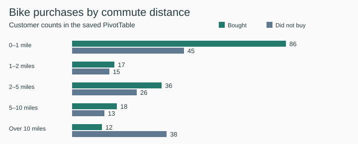

# Bike buyer analysis in Excel

How does commute distance vary between people who bought a bike and those who did not? This workbook explores that question alongside customer age and income using Excel PivotTables and a dashboard.

[Download the Excel workbook](./Excel%20Project%20Dataset.xlsx) and open the **Dashboard** sheet to explore all three comparisons.

## Reading the commute chart

In the saved PivotTable, **86 of 131** customers in the 0–1 mile group bought a bike (66%), compared with **12 of 50** in the over-10-mile group (24%). These percentages describe the saved selection. Its counts total **306 customers**, while the working sheet holds **1,000 records**, including 481 buyers. Changing filters in Excel can change the comparison.

## Inside the workbook

| Sheet | What to explore |
|---|---|
| bike_buyers | Source records, including commute distance, income, age and purchase status. |
| Working sheet | Prepared records with an age bracket for each customer. |
| Pivot Table | Purchase counts by commute distance and age bracket, plus average income by gender and purchase status. |
| Dashboard | Charts bringing the three comparisons together. |
